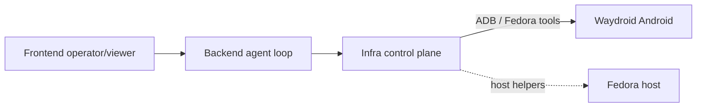

# waydroid-computer-use

Android **computer-use** stack for [Waydroid](https://waydro.id/) (Android in a container on Fedora): see the screen, tap/swipe/type, and drive apps from Grok Bot agents.

**PoC done flag:** install a tic-tac-toe game from the Play Store and **win a match** via this stack.

## Team

| Role | Owns |
|------|------|
| **Infra** | Control primitives, Play Store path, host access |
| **Backend** | Agent loop |
| **Frontend** | Operator / viewer UI |
| Off limits | Generalist, Secretary |

## Reach the Waydroid host

Reverse SSH rendezvous is **pop-os only** (never macbook):

```bash
ssh -p 2201 -i ~/.ssh/waydroid_agents -o StrictHostKeyChecking=accept-new waydroid@127.0.0.1
```

Optional later: `adb connect 127.0.0.1:5555` (when adbd is forwarded).

## Architecture (sketch)



- **ADB** is the primary control path (screenshot, `input tap/swipe/text`, keyevents).
- **Fedora underneath** is the opportunity vs stock Android: host-side capture, packaging, services, scripts.

## Repo layout

```
control/     # screenshot / tap / swipe / type primitives (Infra)
agent/       # agent loop (Backend) — stub
ui/          # operator/viewer (Frontend) — stub
docs/        # architecture, community survey
```

## Status

| Area | Status |
|------|--------|
| Host access (reverse SSH) | Live |
| README / architecture | In progress |
| Control primitives | In progress |
| Play Store / GAPPS | Probing |
| Community survey | In progress |
| PoC tic-tac-toe win | Not started |

## Quick control stubs

See [`control/`](./control/) — thin ADB wrappers. Prefer adapting community Android GUI-agent ideas where they fit; implement what Waydroid makes easier on the host.
