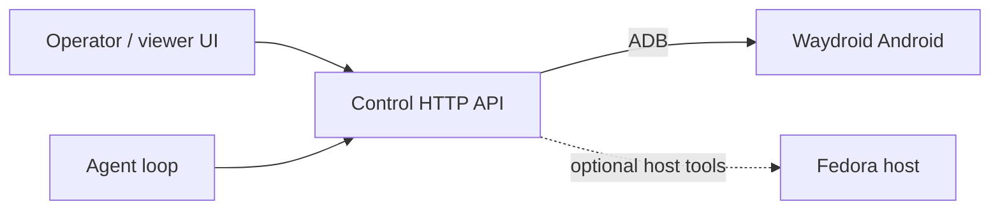

# waydroid-computer-use

**Computer-use for [Waydroid](https://waydro.id/) on Fedora**: see the Android screen, tap/swipe/type, and drive apps from an agent or a human operator UI.

This repo is a **general** control stack (ADB-backed HTTP API + agent loop + viewer). It is **not** a tic-tac-toe product — a Play Store → tic-tac-toe → win path exists only as a **PoC done flag**.

## Assumptions

- **Waydroid on Fedora** is the only environment assumption.
- How you reach that host (SSH, VPN, LAN, reverse tunnel, …) is **your** deployment concern. Configure it; do not bake lab topology into this repo.

## Architecture



| Layer | Path | Role |
|-------|------|------|
| **Control** | `control/` | App-agnostic primitives + HTTP (`/health`, `/frame`, `/actions`, `/action`) |
| **Agent** | `agent/` | TypeScript loop + `HttpControlBackend`; PoC policy under `agent/src/poc/` |
| **Viewer** | `ui/` | Vite/React operator UI (configurable API base) |
| **Docs** | `docs/` | Architecture, survey, agent loop, PoC notes |

Canonical action shapes: [`control/schema.json`](./control/schema.json)  
(`screenshot` / `tap` / `swipe` / `type` / `keyevent`)

## Quickstart

### 1. Configure

```bash
cp .env.example .env
# Set WAYDROID_SSH_* if you use scripts/ssh-waydroid.sh
# Set CONTROL_* / ADB* for the control server
```

Optional SSH helper (no hardcoded hosts):

```bash
./scripts/ssh-waydroid.sh
```

### 2. On the Fedora host: ADB + Waydroid

Install `android-tools`, start a Waydroid session, then connect ADB (e.g. `waydroid adb connect`). You should see a device in `adb devices`.

### 3. Control HTTP API

Run on a host that can talk to that ADB device (usually the Fedora box):

```bash
export CONTROL_HOST=0.0.0.0
export CONTROL_PORT=8765
# optional: export ADB_SERIAL=...
python3 control/http_server.py
```

| Method | Path | Notes |
|--------|------|-------|
| `GET` | `/health` | `{ ok, adb }` |
| `GET` | `/frame` | PNG screenshot |
| `GET` | `/actions` | Schema catalog + optional `recent` history |
| `POST` | `/action` | Sync body matching `control/schema.json` |

CLI wrappers (same ops): [`control/adb_primitives.sh`](./control/adb_primitives.sh)

### 4. Viewer UI

```bash
cd ui
cp .env.example .env   # set VITE_API_BASE=http://<control-host>:<port>
npm install
npm run dev
```

Contract details: [`ui/docs/http-contract.md`](./ui/docs/http-contract.md)

### 5. Agent loop

```bash
cd agent
npm install
npm test && npm run build
```

Point `HttpControlBackend` at your control base URL (env such as `CONTROL_BASE_URL`). See [`docs/agent-loop.md`](./docs/agent-loop.md) and [`agent/README.md`](./agent/README.md).

## PoC (flag only)

**Done flag:** install a tic-tac-toe game from the Play Store and win a match via the stack.

Implementation lives under **`agent/src/poc/`** (`TicTacToePocPolicy`) and [`docs/poc-tic-tac-toe.md`](./docs/poc-tic-tac-toe.md).  
**Do not** put game- or app-specific logic in `control/` — the control plane stays app-agnostic.

## Generalize constraint

- No lab IPs, hostnames, key paths, or agent names in product code/docs.
- Config via `.env` / environment variables only.
- Secrets never committed (see `.gitignore`).

## Deeper docs

| Doc | Contents |
|-----|----------|
| [`docs/architecture.md`](./docs/architecture.md) | Layers + action schema |
| [`docs/community-survey.md`](./docs/community-survey.md) | Mobile GUI agents, scrcpy, GAPPS paths |
| [`docs/agent-loop.md`](./docs/agent-loop.md) | Agent loop design |
| [`docs/poc-tic-tac-toe.md`](./docs/poc-tic-tac-toe.md) | PoC policy notes |
| [`control/README.md`](./control/README.md) | Primitives + HTTP |
| [`ui/README.md`](./ui/README.md) | Viewer |

## License

MIT — see [`LICENSE`](./LICENSE).
