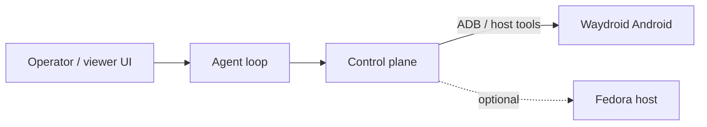

# waydroid-computer-use

Android **computer-use** stack for [Waydroid](https://waydro.id/) on **Fedora**: see the screen, tap/swipe/type, and drive apps from an agent.

**PoC done flag:** install a tic-tac-toe game from the Play Store and **win a match** via this stack.

## Assumptions

- **Waydroid on Fedora** is the only environment assumption.
- How you reach that host (SSH, VPN, LAN, reverse tunnel, etc.) is **your** deployment concern — configure it; do not hardcode lab topology in this repo.

## Configuration

Copy `.env.example` → `.env` (never commit `.env`) or export the same variables:

| Variable | Purpose | Example |
|----------|---------|---------|
| `WAYDROID_SSH_HOST` | Reachable hostname/IP of the Fedora/Waydroid host | `waydroid.example` |
| `WAYDROID_SSH_PORT` | SSH port | `22` |
| `WAYDROID_SSH_USER` | SSH user | `waydroid` |
| `WAYDROID_SSH_IDENTITY` | Optional private key path | `~/.ssh/id_ed25519` |
| `ADB_SERIAL` | Optional `adb -s` serial | `emulator-5554` |
| `ADB` | adb binary override | `adb` |

Helper: `scripts/ssh-waydroid.sh` wraps SSH using those variables.

## Architecture (sketch)



- **ADB** is the primary control path (screenshot, `input tap/swipe/text`, keyevents).
- **Fedora underneath** is the opportunity vs stock Android: host-side capture, packaging, services, scripts.

## Repo layout

```
control/     # screenshot / tap / swipe / type primitives + action JSON Schema
agent/       # agent loop
ui/          # operator/viewer UI
scripts/     # SSH/ADB helpers driven by env config
docs/        # architecture, community survey
```

## Status

| Area | Status |
|------|--------|
| README / architecture (generic) | Current |
| Control primitives (ADB stubs) | Scaffolded |
| Action JSON Schema | `control/schema.json` |
| Play Store / GAPPS | In progress |
| Community survey | In progress |
| PoC tic-tac-toe win | Not started |

## Quick control stubs

See [`control/`](./control/) — thin ADB wrappers. Prefer adapting community Android GUI-agent ideas where they fit; implement what Waydroid makes easier on the host.
